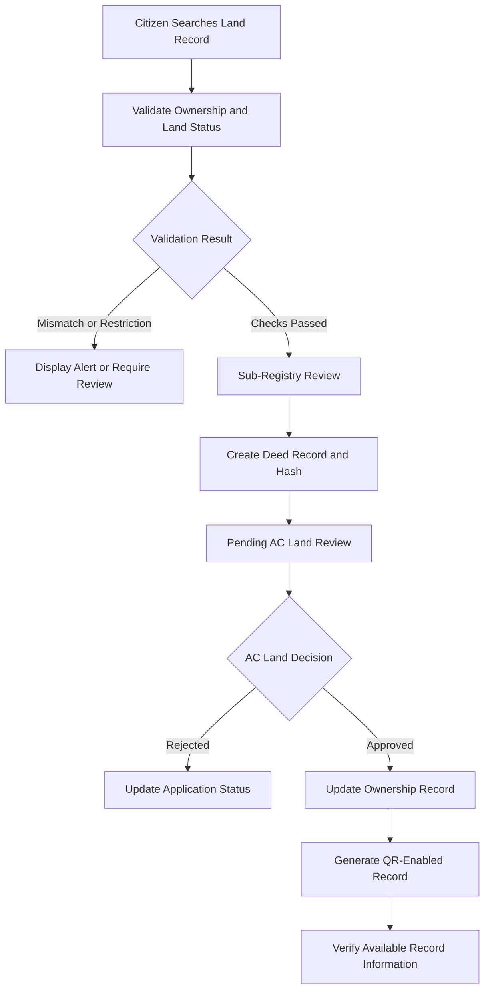

| Name | Role | Student ID |
| Md Saad Hossain | Team Lead | 241-15-541 |
| Chand Mandol | Contributor | 241-15-157 |

**You can findd it on landing page also .....just click and login from there... you are requested yo watch the video on landing page**
| Role | Email | Password |
|---|---|---|
| Super Admin | admin@evhumi.gov.bd | Admin@123456 |
| Register Office | registry@evhumi.gov.bd | 123456 |
| AC Land Office | acland@evhumi.gov.bd | 123456 |
| Citizen User | citizen@example.com | 123456 |

# e-ভূমি (e-Vhumi)
### Smart Digital Land Management & Anti-Fraud Platform

A Civic-Tech Prototype for Transparent Land Records, Ownership Verification, and Fraud Prevention in Bangladesh.

---

## Table of Contents

- [Project Overview](#project-overview)
- [Contributors](#contributors)
- [Demo Accounts](#demo-accounts)
- [Problem Statement](#problem-statement)
- [Proposed Solution](#proposed-solution)
- [Key Features](#key-features)
- [User Roles and Workflow](#user-roles-and-workflow)
- [Technology Stack](#technology-stack)
- [Installation and Setup](#installation-and-setup)
- [Hackathon Demo and Testing](#hackathon-demo-and-testing)
- [Current Limitations](#current-limitations)
- [Future Scope](#future-scope)
- [Security, Privacy, and Legal Considerations](#security-privacy-and-legal-considerations)
- [Project Information](#project-information)

---
**AI USED**
## AI Tools and Intelligent Validation

### AI-Assisted Development

- **Google Gemini (Advanced & 2.0 / 3.8 Flash)**
  - Designed complex land-record validation logic and generated edge-case testing scenarios.
  - Assisted in translating Bangladesh land-record legal principles into programmatic validation rules.

- **GitHub Copilot / DeepMind Antigravity AI Engine**
  - Assisted with full-stack code optimization, resilient fallback architecture, and structured error-handling mechanisms.

### AI Heuristic Rule Engine (In-Code Logic)

- **Multilingual Digit Normalization:** Converts Bengali digits to English digits and vice versa for consistent data processing.
- **Cross-Reference Validation:** Compares NID numbers, Dag numbers, and Khatian records to identify inconsistencies.
- **Fraud Pattern Analysis:** Applies rule-based pattern analysis to flag suspicious records and potential land-transaction fraud.

*Note: AI-assisted development tools support implementation and testing, while the in-code heuristic rule engine performs the configured validation checks. Flagged inconsistencies require further verification and do not independently establish fraud.*

## Project Overview

**e-ভূমি (e-Vhumi)** is a digital land management prototype designed to improve transparency, simplify ownership verification, and reduce the risk of fraudulent land transactions in Bangladesh.

The platform demonstrates a role-based workflow connecting citizens, Sub-Registry Offices, and AC Land Offices. It combines structured land records, transaction-status validation, SHA-256 hashing, QR-based verification, and automated alerts to help identify potential inconsistencies before a land transaction proceeds.

The project focuses on addressing common challenges such as double-selling, ownership mismatches, pending mutation applications, and verification of legal restrictions associated with land records.

| Project Detail | Description |
|---|---|
| Project Name | e-ভূমি (e-Vhumi) |
| Category | GovTech, Civic-Tech, Smart Governance |
| Target Country | Bangladesh |
| Pilot Area | Shibganj Upazila, Bogura District |
| Project Type | Hackathon Prototype |
| Primary Focus | Digital Land Management and Fraud Prevention |

## Contributors


## Demo Accounts

Use the following accounts to explore the supported application workflows.


**Important:** Copy passwords exactly as shown, without adding leading or trailing spaces. These credentials are intended for the demonstration environment. Never publish real administrative credentials or production secrets in a public repository.

---

## Problem Statement

Land-related services can involve fragmented records, complicated administrative procedures, limited access to verification, and opportunities for fraudulent transactions.

Citizens may struggle to verify ownership information or determine whether a proposed transaction conflicts with an existing record, pending mutation, court case, or other restriction.

e-Vhumi demonstrates a technology-assisted approach to making land-record verification and ownership-transfer workflows more transparent and traceable.

## Proposed Solution

| Challenge | e-Vhumi Approach |
|---|---|
| Double-selling risk | Validate land status and block conflicting transactions in supported workflows. |
| Ownership mismatch | Compare seller information against available ownership records and flag inconsistencies. |
| Suspected forged documents | Use SHA-256 hashes and QR-linked record verification to help detect changes or mismatches. |
| Mutation tracking difficulties | Demonstrate a digital workflow between the Sub-Registry Office and AC Land Office. |
| Limited access to verification | Provide a public-facing portal for checking supported land-record information. |
| Court cases and stay orders | Flag recorded restrictions and litigation information where relevant data is available. |
| Excessive land transfer | Validate the requested transfer area against the available recorded area where supported. |

---

## Key Features

### 1. Citizen Verification Portal

The public verification interface helps users check available land information before proceeding with a transaction.

- Search using supported identifiers such as Mouza, Dag number, and seller NID.
- Review ownership information available in the system.
- Display warnings for recorded restrictions, ownership inconsistencies, or government land classifications when corresponding data exists.
- Present verification results through an accessible interface.

**Purpose:** Help citizens identify potential risks before proceeding with a land transaction.

### 2. Fraud Detection and Alert Engine

The prototype includes validation rules intended to identify potentially conflicting or suspicious transactions.

- **Double-Selling Prevention:** Check whether a land record has already been sold or is involved in a pending ownership transfer.
- **Fake Owner Detection:** Flag mismatches between the seller's identity information and the available ownership record.
- **Pending Mutation Lock:** Restrict conflicting transactions while an ownership transfer is awaiting approval.
- **Court Case and Stay-Order Alerts:** Flag applicable restrictions recorded in the available system data.
- **Government Land Checks:** Identify records classified as government Khas land where classification data is available.
- **Area Validation:** Detect transfer requests that exceed the available recorded land area.

**Important:** These checks depend on the accuracy and completeness of available records. A mismatch is a reason for further verification, not automatic proof of fraud. Reliable real-world validation requires authoritative government and judicial integrations.

### 3. Sub-Registry and AC Land Workflow

The platform demonstrates a digital workflow for registering a deed and processing an ownership transfer.

#### Sub-Registry Office

- Enter buyer, seller, and land-record information.
- Record relevant deed reference information, such as volume book and page.
- Validate ownership and transaction status against available records.
- Generate a SHA-256 hash for supported deed data.
- Move the transaction into a pending-review state.

#### AC Land Office

- Review submitted mutation information.
- Approve or reject applications through the supported workflow.
- Update ownership and land status after approval.
- Generate a QR-code-enabled mutation record where supported.

**Expected outcome:** A more traceable workflow between deed registration and mutation instead of an isolated, paper-dependent process.

### 4. Ministry and Super Admin Dashboard

The administrative interface supports system-level management functions available in the prototype.

- Role-based officer account management.
- Administrative monitoring and access control.
- User account management, including supported blocking and unblocking operations.
- Visibility into available system records and dashboard metrics.

National-level analytics and centralized government monitoring require comprehensive, authorized data integration. The prototype should not be interpreted as providing live nationwide coverage.

### 5. Authentication and Access Control

The platform uses authentication and authorization mechanisms to separate user roles and protect restricted dashboard functions.

- JSON Web Token (JWT)-based authentication.
- Role-Based Access Control (RBAC).
- Email OTP verification where configured.
- Password hashing using bcrypt.
- Hybrid data-handling or fallback mechanisms where implemented.

**Security note:** Production deployment requires additional security review, robust session and token management, rate limiting, audit logging, secure configuration, and appropriate data-protection controls.

### 6. QR-Based Record Verification

The prototype uses QR codes to provide access to supported land-record verification information.

- Generate QR codes linked to supported records or verification pages.
- Use SHA-256 hashing to help detect differences between checked data and a previously recorded hash.
- Provide a convenient way to access available verification information.

A hash alone does not establish legal ownership or prove that the original document was issued by a government authority. Trusted source records, access controls, and appropriate digital-signature or official verification mechanisms are necessary for stronger assurance.

---

## User Roles and Workflow

### User Roles

| Role | Main Responsibilities |
|---|---|
| Citizen | Check available land records, submit supported ownership claims, and track relevant transactions. |
| Sub-Registry Office | Enter deed information, validate supported records, and initiate the registration workflow. |
| AC Land Office | Review mutation applications and update ownership records through the supported approval workflow. |
| Super Admin | Manage authorized user roles and oversee available system-level functions. |
| Public Visitor | Access the public verification interface without entering a restricted administrative dashboard. |

### Transaction Workflow

The following diagram illustrates the intended transaction workflow.



The diagram represents the intended workflow. Exact steps depend on the features implemented and the configuration of the prototype.

---

## Technology Stack

### Frontend

| Technology | Purpose |
|---|---|
| React 19 | User interface development |
| Vite | Development server and build tooling |
| Tailwind CSS and Custom CSS | Responsive styling |
| Lucide React | Interface icons |
| React Router DOM | Client-side routing |
| QRCode.react | QR-code generation |
| jsPDF | PDF generation |
| html2canvas | HTML-to-image rendering |

### Backend

| Technology | Purpose |
|---|---|
| Node.js | JavaScript runtime |
| Express.js | API and server framework |
| MongoDB / MongoDB Atlas | Database, where configured |
| Mongoose | MongoDB object modeling |
| JSON Web Token (JWT) | Authentication |
| bcryptjs | Password hashing |
| Node.js Crypto | SHA-256 hashing and cryptographic utilities |
| Helmet | HTTP security headers |
| CORS | Cross-origin access configuration |
| Nodemailer | Email delivery and OTP workflows |

### Data Storage

The project is described as supporting MongoDB-based storage and fallback mechanisms. Actual persistence behavior depends on the backend configuration.

In-memory storage may lose data when the server restarts, so it should not be treated as a production database.

---

## Installation and Setup

### Prerequisites

Install the following before running the project:

- [Node.js and npm](https://nodejs.org/)
- [Git](https://git-scm.com/)
- MongoDB or MongoDB Atlas, if database-backed features are required.

### Step 1: Clone the Repository

Open a terminal and run:

```bash
git clone https://github.com/saifsaad03/evumi.git
cd evumi
```

### Step 2: Configure the Backend

Navigate to the backend directory:

```bash
cd backend
npm install
```

Configure the required environment variables using the project's supported configuration. Typical settings may include:

- Database connection string.
- JWT secret.
- Email service credentials.

Do not commit real secrets or production credentials to GitHub.

Start the backend:

```bash
npm start
```

The backend is expected to use `http://localhost:5000` if that is the port configured in the project.

### Step 3: Configure the Frontend

Open a second terminal from the repository root:

```bash
cd evumi/frontend
npm install
npm run dev
```

If the terminal is already inside the `evumi` directory, run:

```bash
cd frontend
npm install
npm run dev
```

The Vite development server commonly uses `http://localhost:5173`, unless configured otherwise.

### Step 4: Open the Application

Open the local frontend URL displayed in your terminal and test the workflows supported by your current configuration.

**Setup note:** Confirm commands, ports, environment variables, and scripts against the repository's actual `package.json` files and backend configuration.

---

## Hackathon Demo and Testing

The application can be demonstrated through the supported user roles.

| Demo Role | Suggested Test |
|---|---|
| Citizen | Search for a land record and review available verification information. |
| Sub-Registry Office | Initiate a supported deed-registration workflow. |
| AC Land Office | Review a pending mutation application and test the available approval workflow. |
| Super Admin | Explore available administrative functions and account management. |
| Public Visitor | Test QR-based access and available public record checks. |

### Suggested Testing Scenarios

1. **Ownership Verification:** Check whether seller information matches the available ownership record.
2. **Double-Selling Prevention:** Attempt a conflicting transaction against a record already sold or locked by a pending transfer.
3. **Pending Mutation:** Verify whether the configured workflow restricts conflicting transfers while mutation is pending.
4. **Area Validation:** Test a transfer request that exceeds the recorded land area.
5. **Restriction Alerts:** Check whether available court-case or government-land classifications trigger the expected warnings.
6. **QR Verification:** Generate and scan a QR code to access the supported record-verification page.
7. **Role-Based Access:** Confirm that restricted dashboards and actions require the appropriate user role.

Test outcomes depend on the available demo data and the implemented validation rules.

---

## Current Limitations

The current prototype should be distinguished from a fully deployed national land-governance system.

| Area | Current Limitation | Future Direction |
|---|---|---|
| Geographic Coverage | Pilot-focused land records | Expand gradually using authorized, verified records. |
| Identity Verification | Available identity checks and configured OTP workflow | Integrate authorized identity-verification services. |
| Court Information | Depends on available prototype data | Explore authorized judicial-data integration. |
| Payment Processing | Payment may be simulated | Integrate an authorized payment gateway and reconciliation. |
| OTP Delivery | Email-based and configuration-dependent | Add verified SMS delivery and abuse prevention. |
| GIS and Mouza Maps | Depends on available mapping data and interface | Add verified geospatial boundaries and interactive maps. |
| Document Authenticity | Hashing and QR-based verification have limitations | Add trusted source validation and legally appropriate digital signatures. |
| Auditability | Depends on current logging implementation | Introduce tamper-evident audit trails and stronger monitoring. |
| Data Integration | Not equivalent to a live national government database | Establish authorized, secure data-sharing arrangements. |

---

## Future Scope

Planned enhancements include:

- **Nationwide Expansion:** Extend coverage beyond the pilot area after validating records and obtaining the necessary authorization.
- **Official Identity Verification:** Connect to authorized identity-verification services where permitted.
- **Judicial Integration:** Verify applicable court cases and stay orders using trusted, authorized sources.
- **Secure Digital Documents:** Add secure document storage, integrity checks, and legally recognized digital-signature workflows where required.
- **Interactive GIS Mapping:** Visualize verified Mouza boundaries and land parcels using appropriate geospatial data.
- **Real Payment Integration:** Support authorized mutation-fee payment, transaction reconciliation, and receipt generation.
- **Improved Notifications:** Add secure SMS and email notifications, delivery tracking, and OTP expiry controls.
- **Audit Trails:** Record significant user actions, status changes, timestamps, and relevant before-and-after values.
- **Partial Plot Transfers:** Support verified subdivision, multiple ownership interests, and accurate remaining-area calculations.
- **Production-Grade Security:** Introduce security testing, monitoring, backup and recovery procedures, and privacy controls.

---

## Security, Privacy, and Legal Considerations

Land records and identity information are sensitive. A real-world deployment would require:

- Authorized access to official data sources.
- Data minimization and appropriate privacy safeguards.
- Secure handling of NID information and personal records.
- Strong authentication, authorization, and session management.
- Protected secrets and secure production configuration.
- Audit logs, backups, and incident-response procedures.
- Legal and administrative validation of transaction rules.
- Clear separation between demo data and authoritative government records.

**Disclaimer:** e-ভূমি is a hackathon prototype and does not independently establish legal title to land. Official ownership and transaction decisions must remain subject to applicable laws, authoritative records, and authorized government processes.

---

## Project Information

| Item | Details |
|---|---|
| Project Name | e-ভূমি (e-Vhumi) |
| Category | GovTech / Civic-Tech / Smart Governance |
| Focus | Digital Land Management and Fraud Prevention |
| Target Country | Bangladesh |
| Pilot Area | Shibganj Upazila, Bogura District |
| Project Type | Hackathon Prototype |
| Repository | [GitHub: saifsaad03/evumi](https://github.com/saifsaad03/evumi) |
| License | ISC, subject to the repository's actual license file |

---

*Built to demonstrate how digital verification, traceable workflows, and technology-assisted validation can help make land-related services more transparent and accessible in Bangladesh.*
